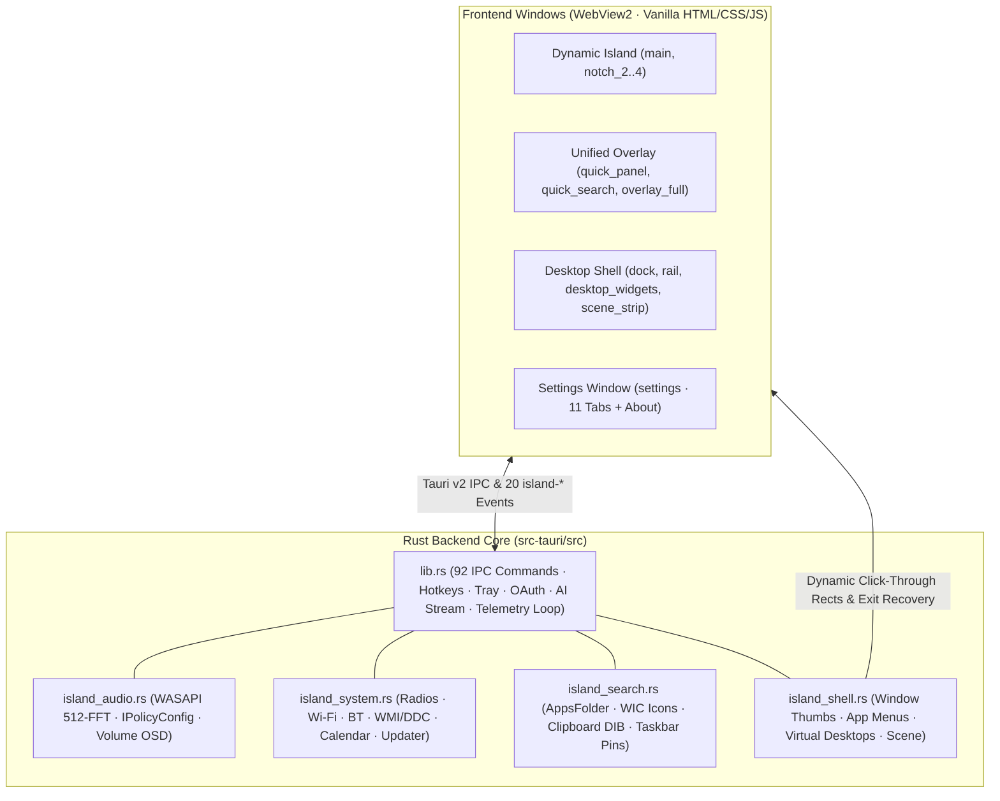

<div align="center">


# Island

**Native Dynamic Island & Desktop Shell Suite for Windows 10 / 11**

[](https://github.com/ThanhDuy-Dev2006/Island/releases)
[](https://github.com/ThanhDuy-Dev2006/Island)
[](https://v2.tauri.app/)
[](https://www.rust-lang.org/)
[](#architecture)
[](#architecture)

<p>
  <strong>English</strong> &nbsp;·&nbsp; <a href="README.vi.md">Tiếng Việt</a>
</p>

<p>
  <a href="#download">Download</a> ·
  <a href="#why-island">Why Island?</a> ·
  <a href="#feature-highlights">Features</a> ·
  <a href="#architecture">Architecture</a> ·
  <a href="#keyboard-shortcuts">Shortcuts</a> ·
  <a href="#getting-started">Getting Started</a> ·
  <a href="#google-tasks-oauth-20">Google Tasks</a> ·
  <a href="#security-privacy--safety">Security</a>
</p>

</div>

---

## Download

Ready to use **Island v1.2.0** immediately on **Windows 10 / 11 (x64)** without compiling from source? Download either package directly from GitHub Releases:

| Package | Direct Download | Best For |
| :--- | :--- | :--- |
| **Windows x64 Installer (Recommended)** | [**Island_1.2.0_x64-setup.exe**](https://github.com/ThanhDuy-Dev2006/Island/releases/latest/download/Island_1.2.0_x64-setup.exe) | Guided NSIS setup with Start Menu shortcut, clean uninstall & optional Windows startup |
| **Windows x64 Portable (No Install)** | [**island.exe**](https://github.com/ThanhDuy-Dev2006/Island/releases/latest/download/island.exe) | Instant launch from any folder (stores preferences beside the executable or in `%APPDATA%\Island`) |

- Browse release notes & SHA-256 checksums: [GitHub Releases (`v1.2.0`)](https://github.com/ThanhDuy-Dev2006/Island/releases/tag/v1.2.0)

> [!NOTE]
> Open-source builds are not Authenticode-signed. If Microsoft Defender SmartScreen prompts on first launch, click **More info → Run anyway**.

---

## Why Island?

**Island** transforms the top edge and desktop workflow of Windows into a fluid, hardware-accelerated command hub built on **Tauri v2**, **native Rust Win32/COM/WASAPI/WinRT APIs**, and a **zero-bundler WebView2 frontend**:

- **Truly Native Windows Core:** Real-time 512-sample WASAPI loopback FFT audio spectrum, SMTC media integration, `IPolicyConfig` audio device switching, WMI + DDC/CI + software gamma brightness control, WinRT Bluetooth/Wi-Fi radios & Windows Calendar appointments, and Explorer Taskbar pin synchronization — implemented directly in Rust without Node runtime overhead.
- **Modular Floating Shell Suite:** Combines an expandable **Dynamic Island** (plus **Capsule Idle** compact mode) with **Quick Panel**, **Quick Search**, **App Grid**, **Window Overview** with Virtual Desktops, **Deck**, **Rail**, **Desktop Widgets**, **Scene Workspace**, and **4 Hot Corners**.
- **Privacy & Desktop Safety First:** Strict local file storage (`%APPDATA%\Island` or portable beside the executable), explicit 10-window capability allowlist (no `*` wildcards), OAuth token isolation, and automatic exit/startup recovery for Taskbar visibility, monitor brightness, and window placement.
- **Ultra-Light Footprint:** Zero Electron bloat, zero frontend build step (`npm run tauri build` bundles directly from `src/`), LTO + `panic = "abort"` release profile, and smart empty-area Win32 click-through (`WS_EX_TRANSPARENT`) so shell overlays never block desktop interaction.

---

## Feature Highlights

### 1. Dynamic Island & Capsule Idle
- **10 Switchable Island Views:** Music & Synced Lyrics, Today & Schedule, GPS Weather, Dual Widgets, Pomodoro, Water Reminder, File Shelf & Clipboard, Todo & Google Tasks, Prayer Times, and AI Copilot.
- **Capsule Idle Modules:** Keep the collapsed top pill ultra-compact while still surfacing live widgets (audio bars, active timer, weather badge, meeting countdown, camera/mic status).
- **13 Interactive Pets & 16 Moods:** Choose from `Aura`, `Cyber Robot`, `Island Spirit`, `Neko`, `Mochi Bunny`, `Kitsune Fox`, `Ruri Dragon`, `Bambu Panda`, `Shiba`, `Axolotl`, `Galaxy Owl`, `Pingu Penguin`, and `Rainbow Unicorn`, complete with custom per-species glow halos and reduced-motion ergonomics.
- **15 Theme Presets & 12 System Accents:** Supports Dark/Light/Auto modes, `.islandtheme` whitelist-validated import/export, 13 animated weather sky themes, multi-monitor notch instances (`notch_2..4`), and customizable hover delay (`0ms` / `140ms` / `420ms`).
- **Live System Telemetry & Hardware Popups:** Real-time Camera/Microphone privacy dots (Windows ConsentStore), live browser/Steam/Microsoft Store download progress in Live Activity, USB/Bluetooth device connection toasts, CPU/RAM/Network stats, and native volume OSD toggle.

### 2. Real-Time Audio Engine
- **WASAPI Loopback 16-Band FFT:** 512-sample live capture feeding 4 visualizer modes (`Bars`, `16-Band Spectrum`, `Wave`, `Dots`) and dynamic **Aurora** album-art color glow.
- **SMTC Playback & Karaoke Lyrics:** Play/Pause, Next/Previous, track metadata, cover art, and time-synced karaoke lyrics inside the expanded Island or Quick Panel.
- **1-Click Audio Output Switcher:** Enumerates active audio endpoints and switches default playback device instantaneously via Win32 `IPolicyConfig`.

### 3. Desktop Shell Suite

| Component | Capabilities |
| :--- | :--- |
| **Quick Panel** | 19 customizable tiles (`CC` grid editor), inline Wi-Fi scanner & connector, 1-click Bluetooth audio switcher, multi-tier brightness slider (WMI + DDC/CI + Gamma), master volume & output selector, and media controller. |
| **Quick Search** | Spotlight-style overlay (`Ctrl+1..4` tabs): Installed Apps (`FOLDERID_AppsFolder` with WIC icons), Local & Recent Files with category filters, inline math evaluator (`= sqrt(144) + 8`, `15% of 200`), System Actions, and rich Clipboard History (Text, `#RRGGBB` color swatches, `CF_DIB` Images, instant QR). |
| **Deck** | Bottom floating dock with smooth icon magnification, bi-directional sync with pinned Windows Taskbar items (`Taskband\Favorites` + `User Pinned\TaskBar`), running window previews on hover, Downloads Stack, Recycle Bin integration, smart auto-hide, and click-through regions. |
| **Rail** | Top edge menu bar that splits cleanly around the Dynamic Island notch, surfacing foreground application menus & keyboard shortcuts, Wi-Fi status, Battery indicator, Quick Search trigger, Quick Panel trigger, and Clock. |
| **Desktop Widgets** | 7 snap-to-16px-grid widgets (`Analog Clock`, `Digital Clock`, `World Clock`, `Calendar & Meetings`, `Month Calendar`, `Battery`, `System Performance`) in `Original` and `Crystal` glass styles. |
| **App Grid & Overview** | Full-screen categorized application launcher and live Window Overview (`PrintWindow` thumbnails) with Virtual Desktop management. |
| **Scene & Hot Corners** | Left-edge 3D Scene window switcher (parks inactive windows neatly aside and unparks safely on exit) + configurable actions for all 4 screen corners. |

### 4. Productivity, File Tools & AI Copilot
- **File Shelf & Quick Actions:** Drag-and-drop temporary file tray with 50% image resize, lossless WIC JPG/PNG conversion, and one-click `.zip` compression saved alongside originals.
- **LAN Wi-Fi QR File Transfer:** Spins up an ephemeral local HTTP server protected by a random session token and strict private-LAN/loopback IP filtering so phones can scan the QR code and pull files over local Wi-Fi with live transfer progress.
- **Screen Color Picker (`Alt+C`):** Native pixel magnifier & sampler that copies `#RRGGBB` hex colors straight to Clipboard and visualizes swatches inline.
- **Windows Calendar Companion & Todo:** Reads Windows Calendar (`ApplicationModel.Appointments`) for 10-minute pre-meeting countdowns with one-click **Join** buttons for Google Meet / Zoom / Microsoft Teams links; Todo list supports natural-language scheduling (`10m take medicine`, `tomorrow 08:00 ...`) and **two-way Google Tasks OAuth 2.0 loopback sync**.
- **Pomodoro & Hydration:** Multi-mode focus timer (`Work`, `Study`, `Reading`, `Custom`) with persistent countdown across restarts, 7-day focus stats, and customizable water intake reminders.
- **Multi-Model Streaming AI Copilot:** Native Rust SSE streaming chat supporting **Gemini 3.8 Flash**, **Claude Sonnet 4.6**, **Claude Opus 4.6**, **DeepSeek V4 Pro**, **DeepSeek V4.1 Flash**, **GPT-OSS 120B**, and **Muse Spark 1.3**, configurable thinking effort (`Fast` / `Low` / `Medium` / `High`), custom role presets, clipboard image paste (`Ctrl+V`), file drag-and-drop, arbitrary notch drag-resizing, and instant window capture (`Alt+S`).

---

## Architecture



- **Decoupled Dual-Thread Native Loop:** Blocking COM/WinRT/WLAN/clipboard work runs on a dedicated `island-telemetry` `COINIT_MULTITHREADED` thread, keeping the adaptive Win32 cursor/hotkey/hit-test loop (`16ms` active / `36ms` idle) responsive with zero WebView2 UI stalls.
- **Unified Design System (`src/theme-tokens.css`):** Shared glassmorphism tokens, `@starting-style` pop transitions, `linear()` spring physics, and custom range slider styling synchronized live across all windows via Tauri events.

---

## Keyboard Shortcuts

| Shortcut | Action |
| :--- | :--- |
| `Alt + Space` or `Ctrl + Shift + A` | Open Island AI Copilot |
| `Alt + S` | Capture foreground window image directly to AI Copilot |
| `Alt + C` | Launch Screen Color Picker (`#RRGGBB`) |
| `Ctrl + Alt + N` | Quick-add Todo / natural-language reminder |
| `Ctrl + Space` | Toggle **Quick Search** (`Ctrl + 1..4` switches tabs, `Esc` closes) |
| `Ctrl + Shift + Space` | Toggle **App Grid** |
| `Ctrl + ↑` | Toggle **Window Overview** & Virtual Desktops |
| `Ctrl + Alt + C` | Toggle **Quick Panel** |
| `Alt + \`` / `Alt + Shift + \`` | Cycle windows of the active app *(when Quick Window Shortcuts enabled)* |
| `Ctrl + Alt + H` / `M` / `Q` | Hide / Minimize / Quit active app *(when Quick Window Shortcuts enabled)* |

---

## Getting Started

### Prerequisites
- **OS:** Windows 10 (19041+) or Windows 11 (`x64`)
- **Runtime:** [Microsoft Edge WebView2 Runtime](https://developer.microsoft.com/en-us/microsoft-edge/webview2/) (pre-installed on Windows 11)
- **Tooling:**
  - [Node.js](https://nodejs.org/) v18 or newer (used solely for the `@tauri-apps/cli` runner)
  - [Rust](https://www.rust-lang.org/tools/install) toolchain (Edition 2024) + Visual Studio Build Tools (C++ desktop workload)

### Run in Development

```powershell
git clone https://github.com/ThanhDuy-Dev2006/Island.git
cd Island
npm install
npm run tauri dev
```

### Build Release Executable & NSIS Installer

```powershell
npm run tauri build
```

Compiled outputs:
- Standalone binary: `src-tauri/target/release/island.exe`
- Windows x64 installer: `src-tauri/target/release/bundle/nsis/Island_1.2.0_x64-setup.exe`

> [!TIP]
> You can download pre-built binaries directly from the [GitHub Releases](https://github.com/ThanhDuy-Dev2006/Island/releases) page once published, and check for updates directly inside **Settings → About**.

---

## Google Tasks OAuth 2.0

Source releases intentionally ship **without embedded OAuth credentials**. You can enable two-way Google Tasks sync in either of two ways:

1. **Runtime Import (Recommended for Users):**
   - Create an **OAuth 2.0 Client ID (Desktop App)** in [Google Cloud Console](https://console.cloud.google.com/) with scopes `https://www.googleapis.com/auth/tasks` and `https://www.googleapis.com/auth/userinfo.email`.
   - Open **Island Settings → Productivity & Health → Import `client_secret.json`** (or paste Client ID & Secret manually), then click **Connect**.
2. **Compile-Time Injection (Custom Maintainer Builds):**
   ```powershell
   $env:ISLAND_GOOGLE_CLIENT_ID = "your-desktop-client-id.apps.googleusercontent.com"
   $env:ISLAND_GOOGLE_CLIENT_SECRET = "your-client-secret"
   npm run tauri build
   ```

---

## Security, Privacy & Safety

- **Explicit Capability Allowlist:** `src-tauri/capabilities/default.json` grants permissions strictly to the 10 named Island windows (`main`, `notch_*`, `settings`, `quick_panel`, `quick_search`, `overlay_full`, `dock`, `rail`, `desktop_widgets`, `scene_strip`) — never `*`.
- **OAuth Token Isolation:** `google_tasks.txt` is explicitly blocked from generic `save_data_file` / `load_data_file` IPC calls and managed exclusively by dedicated Rust auth commands.
- **Secret Scrubbing:** `save_data_file` sanitizes `settings.txt` before persisting to disk so credentials are never accidentally written into frontend preference dumps.
- **Safe Desktop Shell Recovery:** Enabling experimental Taskbar auto-hide (`hideTaskbar`) or Scene mode (`enableScene`) defaults to `false`; both startup guards and `RunEvent::Exit` automatically restore the Windows Taskbar, reset software display gamma, and unpark all Scene windows if Island exits unexpectedly.
- **Local LAN QR Guardrails:** The temporary QR file server binds strictly to private RFC1918/loopback subnets with per-session random URL tokens and instant shutdown when finished.

---

## Project Structure

```text
Island/
├── package.json                  # Tauri CLI scripts (v1.2.0, zero frontend bundler)
├── README.md                     # Documentation (English)
├── README.vi.md                  # Documentation (Tiếng Việt)
├── src/                          # WebView2 Vanilla HTML / CSS / JS frontend
│   ├── theme-tokens.css          # Shared Dark/Light tokens, accents, springs & glass styles
│   ├── index.html / styles.css / main.js        # Dynamic Island, Capsule, 16-Band FFT, AI, Todos
│   ├── overlay.html / overlay.css / overlay.js  # Quick Panel, Quick Search, App Grid, Overview
│   ├── dock.html / dock.css / dock.js           # Floating Deck & Windows Taskbar pin sync
│   ├── rail.html / rail.css / rail.js           # Top edge Rail & foreground app menus
│   ├── widgets.html / widgets.css / widgets.js  # Desktop Widgets (7 types) & Scene switcher
│   ├── settings.html / settings.css / settings.js # Resizable glass Settings (11 tabs + About)
│   └── pet-*.svg / robot-avatar-dark.svg / icon.png # 13 animated Pet avatars & app icon
└── src-tauri/                    # Rust Tauri v2 & Win32/COM/WASAPI backend
    ├── Cargo.toml                # Crates & optimized LTO Release profile
    ├── tauri.conf.json           # Multi-window config & NSIS bundle target
    ├── hooks.nsh                 # NSIS installer Windows startup & cleanup hooks
    ├── capabilities/default.json # Explicit 10-window capability permissions
    ├── icons/                    # Application icons (.ico / .png / Store tiles)
    └── src/
        ├── main.rs               # Binary entry point
        ├── lib.rs                # 92 IPC commands, hotkeys, tray, OAuth, AI SSE, telemetry loop
        ├── island_audio.rs       # WASAPI 512-sample FFT loopback, IPolicyConfig, OSD control
        ├── island_system.rs      # Wi-Fi/BT radios, WMI/DDC/Gamma brightness, Calendar, Updater
        ├── island_search.rs      # AppsFolder index, WIC PNG icons, CF_DIB clipboard, Taskbar pins
        └── island_shell.rs       # PrintWindow thumbs, Virtual Desktops, App Menus, Scene recovery
```

---

## Verification

Run the built-in syntax checks, Rust unit tests, and static compiler verification before submitting changes:

```powershell
node --check src\main.js
node --check src\settings.js
node --check src\overlay.js
node --check src\dock.js
node --check src\rail.js
node --check src\widgets.js

cargo test --manifest-path src-tauri\Cargo.toml
cargo check --manifest-path src-tauri\Cargo.toml
```

---

## Contributing & Support

- Found a bug or want to propose an improvement? Open an [Issue](https://github.com/ThanhDuy-Dev2006/Island/issues) or submit a Pull Request targeting `main`.
- Built and maintained by [ThanhDuy-Dev2006](https://github.com/ThanhDuy-Dev2006).
