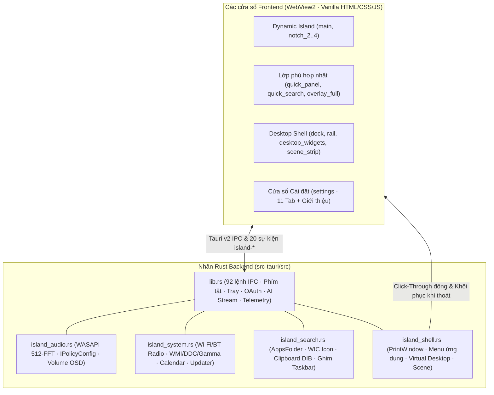

<div align="center">


# Island

**Hệ sinh thái Dynamic Island & Desktop Shell bản địa cho Windows 10 / 11**

[](https://github.com/ThanhDuy-Dev2006/Island/releases)
[](https://github.com/ThanhDuy-Dev2006/Island)
[](https://v2.tauri.app/)
[](https://www.rust-lang.org/)
[](#ki%E1%BA%BFn-tr%C3%BAc-h%E1%BB%87-th%E1%BB%91ng)
[](#ki%E1%BA%BFn-tr%C3%BAc-h%E1%BB%87-th%E1%BB%91ng)

<p>
  <a href="README.md">English</a> &nbsp;·&nbsp; <strong>Tiếng Việt</strong>
</p>

<p>
  <a href="#v%C3%AC-sao-ch%E1%BB%8Dn-island">Vì sao chọn Island?</a> ·
  <a href="#t%C3%ADnh-n%C4%83ng-n%E1%BB%95i-b%E1%BA%ADt">Tính năng</a> ·
  <a href="#ki%E1%BA%BFn-tr%C3%BAc-h%E1%BB%87-th%E1%BB%91ng">Kiến trúc</a> ·
  <a href="#ph%C3%ADm-t%E1%BA%AFt-nhanh">Phím tắt</a> ·
  <a href="#h%C6%B0%E1%BB%9Bng-d%E1%BA%ABn-c%C3%A0i-%C4%91%E1%BA%B7t--bi%C3%AAn-d%E1%BB%8Bch">Biên dịch</a> ·
  <a href="#%C4%91%E1%BB%93ng-b%E1%BB%99-google-tasks-oauth-20">Google Tasks</a> ·
  <a href="#b%E1%BA%A3o-m%E1%BA%ADt-quy%E1%BB%81n-ri%C3%AAng-t%C6%B0--an-to%C3%A0n">Bảo mật</a>
</p>

</div>

---

## Vì sao chọn Island?

**Island** biến cạnh trên màn hình và không gian làm việc Windows thành một trung tâm điều khiển mượt mà, kết hợp **Tauri v2**, **Rust Win32/COM/WASAPI/WinRT bản địa** và **giao diện WebView2 thuần không cần bundler**:

- **Xử lý bản địa bằng Rust:** Bắt phổ âm thanh WASAPI loopback 512 mẫu thời gian thực, điều khiển nhạc SMTC, chuyển đổi đầu ra âm thanh qua `IPolicyConfig`, điều chỉnh độ sáng đa tầng (WMI + DDC/CI + Gamma), bật/tắt Radio Wi-Fi/Bluetooth, đọc lịch hẹn Windows Calendar và đồng bộ ứng dụng ghim trên Taskbar Windows.
- **Bộ Desktop Shell toàn diện:** Tích hợp **Dynamic Island** (kèm chế độ **Viên thuốc Mô-đun / Capsule Idle**) cùng **Quick Panel**, **Quick Search**, **App Grid**, **Window Overview** (hỗ trợ Virtual Desktops), **Deck**, **Rail**, **Desktop Widgets**, **Scene Workspace** và **4 Góc nóng (Hot Corners)**.
- **Ưu tiên quyền riêng tư & an toàn hệ thống:** Dữ liệu lưu cục bộ (`%APPDATA%\Island` hoặc ngay cạnh file chạy), phân quyền Tauri tường minh cho đúng 10 cửa sổ (không dùng `*`), cách ly tệp token OAuth, tự động khôi phục Taskbar, độ sáng màn hình và cửa sổ Scene khi khởi động hoặc thoát ứng dụng.
- **Siêu nhẹ & không cản chuột:** Biên dịch tối ưu `LTO + panic = "abort"`, không qua bước đóng gói bundler Node, và tự động tính toán vùng click-through Win32 (`WS_EX_TRANSPARENT`) trên phần nền trong suốt để không bao giờ che thao tác chuột trên desktop.

---

## Tính năng nổi bật

### 1. Dynamic Island & Viên thuốc Mô-đun (Capsule Idle)
- **10 trang chức năng chuyển đổi linh hoạt:** Âm nhạc & Lời Karaoke, Hôm nay & Lịch biểu, Thời tiết GPS, Tiện ích Đôi (Dual Widgets), Pomodoro, Nhắc uống nước, Khay tệp & Clipboard, Việc cần làm & Google Tasks, Giờ cầu nguyện và Trợ lý AI Copilot.
- **Viên thuốc Mô-đun (Capsule Idle):** Hiển thị gọn nhẹ trạng thái trực tiếp ngay khi đảo nổi ở trạng thái thu gọn (sóng nhạc, bộ đếm Pomodoro, thẻ thời tiết, đếm ngược cuộc họp, chấm Camera/Micro).
- **13 Linh vật (Pets) & 16 Biểu cảm:** `Mắt Tinh Linh Island`, `Robot Cyber`, `Tinh Linh Island`, `Mèo Đêm Neko`, `Thỏ Tuyết Mochi`, `Cáo Lửa Kitsune`, `Rồng Ngọc Ruri`, `Gấu Trúc Bambu`, `Cún Vàng Shiba`, `Kỳ Nhông Axolotl`, `Cú Đêm Ngân Hà`, `Cánh Cụt Pingu`, `Kỳ Lân Cầu Vồng` — hỗ trợ dải hào quang theo loài và chế độ giảm hiệu ứng chuyển động thân thiện.
- **15 Chủ đề giao diện & 12 Màu nhấn:** Hỗ trợ Sáng/Tối/Tự động, xuất nhập chủ đề `.islandtheme` có kiểm duyệt whitelist, 13 chủ đề bầu trời trang Thời tiết, đa màn hình (`notch_2..4`), và tùy chỉnh độ trễ rê chuột (`0ms` / `140ms` / `420ms`).
- **Giám sát hệ thống trực tiếp:** Chấm báo quyền riêng tư Camera/Microphone (ConsentStore), theo dõi tiến trình tải về trên trình duyệt/Steam/Microsoft Store ngay trên Live Activity, thông báo kết nối USB/Bluetooth, thông số CPU/RAM/Mạng và tùy chọn ẩn OSD âm lượng mặc định của Windows.

### 2. Động cơ Âm thanh Thời gian thực
- **Phổ WASAPI Loopback 16 dải (512-sample FFT):** 4 kiểu sóng nhạc (`Cột`, `Phổ 16 dải`, `Sóng`, `Chấm`) kết hợp cực quang **Aurora** đổi màu theo bìa album.
- **Điều khiển SMTC & Lời bài hát:** Phát/Tạm dừng, chuyển bài, hiển thị ảnh bìa và lời Karaoke đồng bộ theo thời gian phát.
- **Chuyển loa / tai nghe 1-chạm:** Liệt kê toàn bộ thiết bị phát và chuyển đầu ra âm thanh mặc định tức thì bằng COM `IPolicyConfig`.

### 3. Bộ công cụ Desktop Shell

| Thành phần | Chức năng chính |
| :--- | :--- |
| **Quick Panel** | 19 ô chức năng tùy biến thứ tự ẩn/hiện, quét & kết nối Wi-Fi, kết nối nhanh thiết bị âm thanh Bluetooth, thanh kéo độ sáng đa tầng (WMI + DDC/CI + Gamma), âm lượng tổng + chọn đầu ra âm thanh, và trình điều khiển nhạc. |
| **Quick Search** | Thanh tìm kiếm nổi (`Ctrl+1..4`): Tìm ứng dụng (`FOLDERID_AppsFolder` kèm icon WIC), tệp cục bộ & gần đây có bộ lọc loại tệp, máy tính biểu thức trực tiếp (`= sqrt(144) + 8`, `15% of 200`), hành động hệ thống và lịch sử Clipboard đa định dạng (Chữ, ô màu `#RRGGBB`, ảnh `CF_DIB`, tạo mã QR tức thì). |
| **Deck** | Thanh ứng dụng nổi đáy màn hình với hiệu ứng phóng đại mượt mà, tự đồng bộ ứng dụng đang ghim từ Taskbar Windows (`Taskband\Favorites` & `User Pinned\TaskBar`), xem trước cửa sổ thu nhỏ khi rê chuột, ngăn Downloads Stack, Thùng rác, tự ẩn theo mép và click-through vùng trống. |
| **Rail** | Thanh menu cạnh trên tự chừa khoảng trống cho tai thỏ Island, hiển thị menu ngữ cảnh ứng dụng đang mở kèm phím tắt, Wi-Fi, Pin, Tìm kiếm nhanh, Quick Panel và Đồng hồ. |
| **Desktop Widgets** | 7 tiện ích gắn lưới 16px trên màn hình nền (`Đồng hồ Kim`, `Đồng hồ Số`, `Giờ Thế Giới`, `Lịch & Cuộc họp`, `Lịch Tháng`, `Pin Hệ Thống`, `Hiệu năng Hệ thống`) với 2 phong cách `Original` và `Crystal`. |
| **App Grid & Overview** | Ngăn kéo ứng dụng toàn màn hình phân loại tự động và chế độ Tổng quan cửa sổ (thumbnail `PrintWindow`) kèm quản lý Virtual Desktops. |
| **Scene & Góc nóng** | Thanh thẻ cửa sổ 3D cạnh trái (gom cửa sổ ít dùng gọn gàng và tự khôi phục khi thoát) + tùy chỉnh hành động cho 4 góc màn hình. |

### 4. Năng suất, Tiện ích Tệp & Trợ lý AI Copilot
- **Khay thả tệp & Thao tác nhanh:** Nén `.zip`, thu nhỏ ảnh 50% và chuyển đổi JPG/PNG qua WIC ngay cạnh tệp gốc mà không ghi đè.
- **Gửi tệp qua Wi-Fi bằng mã QR:** Khởi tạo máy chủ HTTP LAN tạm thời với mã token ngẫu nhiên và khóa chặt dải IP nội bộ/loopback, cho phép điện thoại quét QR để nhận cả khay tệp hoặc từng tệp riêng với thanh tiến độ trực tiếp.
- **Hút màu màn hình (`Alt+C`):** Lấy mã màu `#RRGGBB` tại bất kỳ điểm ảnh nào trên màn hình, chép thẳng vào Clipboard và hiển thị ô màu trực quan.
- **Lịch họp Windows & Việc cần làm:** Đồng bộ sự kiện Windows Calendar (`ApplicationModel.Appointments`), đếm ngược 10 phút trước giờ họp kèm nút **Tham gia** Google Meet / Zoom / Teams; hỗ trợ nhập nhắc giờ tự nhiên (`10m uống thuốc`, `ngày mai 08:00 ...`) và **đồng bộ 2 chiều Google Tasks**.
- **Pomodoro & Nhắc uống nước:** Chia phiên (`Việc`, `Học`, `Đọc`, `Tùy`), lưu trạng thái đếm ngược khi khởi động lại, biểu đồ tập trung 7 ngày và nhắc nhở uống nước định kỳ.
- **Trợ lý AI Copilot đa mô hình:** Streaming SSE bản địa bằng Rust hỗ trợ **Gemini 3.8 Flash**, **Claude Sonnet 4.6**, **Claude Opus 4.6**, **DeepSeek V4 Pro**, **DeepSeek V4.1 Flash**, **GPT-OSS 120B** và **Muse Spark 1.3**; tùy chỉnh 4 mức tư duy, mẫu System Prompt, dán ảnh `Ctrl+V`, kéo thả tệp, kéo giãn kích thước khung AI tự do và chụp nhanh cửa sổ đang mở (`Alt+S`).

---

## Kiến trúc hệ thống



- **Tách luồng chống nghẽn UI:** Các tác vụ chậm (Win32/COM/WinRT/WLAN/Clipboard) chạy trên luồng riêng `island-telemetry` (`COINIT_MULTITHREADED`), giúp vòng lặp chuột/phím tắt (`16ms` chủ động / `36ms` nghỉ) luôn phản hồi tức thì mà không khóa WebView2.
- **Hệ thống Design Token (`src/theme-tokens.css`):** Đồng bộ Dark/Light, màu nhấn, hiệu ứng kính mờ, `@starting-style` và lò xo `linear()` tới toàn bộ 10 cửa sổ theo thời gian thực.

---

## Phím tắt nhanh

| Tổ hợp phím | Chức năng |
| :--- | :--- |
| `Alt + Space` hoặc `Ctrl + Shift + A` | Mở Trợ lý AI Copilot trên Dynamic Island |
| `Alt + S` | Chụp ảnh cửa sổ đang mở gửi thẳng vào AI Copilot |
| `Alt + C` | Bật công cụ hút màu màn hình (`#RRGGBB`) |
| `Ctrl + Alt + N` | Mở ô thêm nhanh Việc cần làm / nhắc hẹn tự nhiên |
| `Ctrl + Space` | Bật/tắt **Quick Search** (`Ctrl + 1..4` đổi tab, `Esc` đóng) |
| `Ctrl + Shift + Space` | Bật/tắt **App Grid** |
| `Ctrl + ↑` | Bật/tắt **Tổng quan cửa sổ (Overview)** & Virtual Desktops |
| `Ctrl + Alt + C` | Bật/tắt **Quick Panel** |
| `Alt + \`` / `Alt + Shift + \`` | Chuyển đổi cửa sổ cùng ứng dụng *(khi bật phím tắt cửa sổ nhanh)* |
| `Ctrl + Alt + H` / `M` / `Q` | Ẩn / Thu nhỏ / Thoát ứng dụng hiện tại *(khi bật phím tắt cửa sổ nhanh)* |

---

## Hướng dẫn cài đặt & biên dịch

### Yêu cầu hệ thống
- **Hệ điều hành:** Windows 10 (19041+) hoặc Windows 11 (`x64`)
- **Môi trường:** [Microsoft Edge WebView2 Runtime](https://developer.microsoft.com/en-us/microsoft-edge/webview2/) (có sẵn trên Windows 11)
- **Công cụ phát triển (khi build từ mã nguồn):**
  - [Node.js](https://nodejs.org/) v18 trở lên (chỉ dùng để chạy `@tauri-apps/cli`)
  - [Rust](https://www.rust-lang.org/tools/install) (Edition 2024) + Visual Studio Build Tools (C++ Desktop Development)

### Chạy môi trường phát triển (Dev)

```powershell
git clone https://github.com/ThanhDuy-Dev2006/Island.git
cd Island
npm install
npm run tauri dev
```

### Đóng gói bản Release & Bộ cài NSIS

```powershell
npm run tauri build
```

Sản phẩm sau khi build:
- Tệp thực thi độc lập: `src-tauri/target/release/island.exe`
- Bộ cài đặt Windows x64: `src-tauri/target/release/bundle/nsis/Island_1.2.0_x64-setup.exe`

> [!TIP]
> Bạn có thể kiểm tra phiên bản phát hành mới trực tiếp trong **Cài đặt → Giới thiệu** hoặc tải bản cài sẵn tại mục [GitHub Releases](https://github.com/ThanhDuy-Dev2006/Island/releases) khi có bản phát hành.

---

## Đồng bộ Google Tasks (OAuth 2.0)

Kho mã nguồn công khai **không đính kèm khóa OAuth bí mật**. Bạn có thể kích hoạt đồng bộ Google Tasks 2 chiều bằng một trong hai cách sau:

1. **Nạp tệp khi sử dụng (Khuyên dùng cho người dùng cuối):**
   - Tạo **OAuth 2.0 Client ID (Desktop App)** trên [Google Cloud Console](https://console.cloud.google.com/) với 2 scope: `https://www.googleapis.com/auth/tasks` và `https://www.googleapis.com/auth/userinfo.email`.
   - Mở **Cài đặt Island → Lịch, Việc & Sức khỏe → Nạp `client_secret.json`** (hoặc dán Client ID & Secret) rồi bấm **Liên kết**.
2. **Nhúng lúc biên dịch (Cho bản dựng phát hành riêng):**
   ```powershell
   $env:ISLAND_GOOGLE_CLIENT_ID = "your-desktop-client-id.apps.googleusercontent.com"
   $env:ISLAND_GOOGLE_CLIENT_SECRET = "your-client-secret"
   npm run tauri build
   ```

---

## Bảo mật, Quyền riêng tư & An toàn

- **Giới hạn quyền Tauri chặt chẽ:** `src-tauri/capabilities/default.json` chỉ cấp quyền tường minh cho 10 nhãn/mẫu cửa sổ (`main`, `notch_*`, `settings`, `quick_panel`, `quick_search`, `overlay_full`, `dock`, `rail`, `desktop_widgets`, `scene_strip`), tuyệt đối không dùng `*`.
- **Cách ly tệp xác thực:** `google_tasks.txt` bị chặn hoàn toàn khỏi lệnh đọc/ghi dữ liệu chung (`save_data_file` / `load_data_file`).
- **Tự động làm sạch khóa nhạy cảm:** `save_data_file` lọc sạch các chuỗi nhạy cảm nếu lỡ xuất hiện trước khi ghi `settings.txt`.
- **Khôi phục an toàn Shell:** Tùy chọn ẩn Taskbar (`hideTaskbar`) và `enableScene` mặc định tắt (`false`); cả lúc khởi động lẫn `RunEvent::Exit` đều tự động hiện lại Taskbar, trả Gamma màn hình và đưa mọi cửa sổ Scene về vị trí bình thường.
- **Khóa mạng nội bộ cho QR File Transfer:** Máy chủ truyền tệp tạm thời chỉ chấp nhận kết nối từ dải IP LAN riêng tư/loopback và yêu cầu token phiên ngẫu nhiên.

---

## Cấu trúc dự án

```text
Island/
├── package.json                  # Cấu hình CLI Tauri v2 (v1.2.0, không bundler)
├── README.md                     # Tài liệu (Tiếng Anh)
├── README.vi.md                  # Tài liệu (Tiếng Việt)
├── src/                          # Giao diện WebView2 (HTML / CSS / JS thuần)
│   ├── theme-tokens.css          # Token hệ thống Sáng/Tối, màu nhấn & hiệu ứng kính mờ
│   ├── index.html / styles.css / main.js        # Đảo nổi, Capsule, Phổ FFT 16 dải, AI, Todo
│   ├── overlay.html / overlay.css / overlay.js  # Quick Panel, Quick Search, App Grid, Overview
│   ├── dock.html / dock.css / dock.js           # Thanh Deck & đồng bộ ghim Taskbar Windows
│   ├── rail.html / rail.css / rail.js           # Thanh Rail & menu ngữ cảnh ứng dụng
│   ├── widgets.html / widgets.css / widgets.js  # Desktop Widgets (7 loại) & thanh Scene
│   ├── settings.html / settings.css / settings.js # Cài đặt 11 danh mục + Giới thiệu
│   └── pet-*.svg / robot-avatar-dark.svg / icon.png # Bộ 13 linh vật SVG & biểu tượng app
└── src-tauri/                    # Nhân Rust Tauri v2 & Win32/COM/WASAPI
    ├── Cargo.toml                # Thư viện hệ thống Windows & profile Release LTO
    ├── tauri.conf.json           # Cấu hình đa cửa sổ & bộ cài NSIS
    ├── hooks.nsh                 # Hook cài đặt & dọn dẹp Startup Windows NSIS
    ├── capabilities/default.json # Quyền Tauri giới hạn cho 10 cửa sổ
    ├── icons/                    # Bộ icon đa độ phân giải Windows
    └── src/
        ├── main.rs               # Điểm vào nhị phân
        ├── lib.rs                # 92 lệnh IPC, phím tắt, khay hệ thống, OAuth, AI SSE, telemetry
        ├── island_audio.rs       # WASAPI 512-FFT loopback, IPolicyConfig, Volume OSD
        ├── island_system.rs      # Radio Wi-Fi/BT, WMI/DDC/Gamma, Calendar Agenda, Updater
        ├── island_search.rs      # Index ứng dụng/tệp, icon WIC PNG, Clipboard ảnh, ghim Taskbar
        └── island_shell.rs       # PrintWindow thumbnail, Virtual Desktops, Menu, khôi phục Scene
```

---

## Kiểm thử mã nguồn

Chạy bộ kiểm tra cú pháp, unit test Rust và biên dịch kiểm chứng trước khi đóng góp mã:

```powershell
node --check src\main.js
node --check src\settings.js
node --check src\overlay.js
node --check src\dock.js
node --check src\rail.js
node --check src\widgets.js

cargo test --manifest-path src-tauri\Cargo.toml
cargo check --manifest-path src-tauri\Cargo.toml
```

---

## Đóng góp & Hỗ trợ

- Phát hiện lỗi hoặc muốn đề xuất tính năng? Hãy mở [Issue](https://github.com/ThanhDuy-Dev2006/Island/issues) hoặc gửi Pull Request vào nhánh `main`.
- Phát triển và duy trì bởi [ThanhDuy-Dev2006](https://github.com/ThanhDuy-Dev2006).
